# Architecture overview

`action1-mcp` is an unofficial Model Context Protocol (MCP) server for the Action1 RMM REST API (package `action1-mcp-server`, TypeScript, ESM, Node >= 22.12, bun as package manager). It turns the Action1 API into `action1_*` MCP tools, a few `action1://` resources and slash prompts, and wraps every state-changing call in a server-side guard. Because it can run scripts on every managed endpoint, most design decisions trade convenience for containment.

## Layers

```mermaid
flowchart TD
  subgraph Entry["Process entry (src/index.ts)"]
    CLI["parseArgs / helpText / main"]
  end
  subgraph Transports
    STDIO["serveStdio (default)"]
    HTTP["createHttpApp: POST /mcp (--http)"]
  end
  CLI --> STDIO
  CLI --> HTTP
  STDIO --> BS["buildServer (src/server.ts)"]
  HTTP --> BS
  BS --> POL["applyToolPolicy + instrumentToolCalls (src/tools/registry.ts)"]
  BS --> TOOLS["register* tool modules, resources, prompts"]
  TOOLS --> GUARD["checkDestructiveGuard / runDestructive"]
  TOOLS --> CLIENT["Action1Client.request / paginate"]
  GUARD --> CLIENT
  CLIENT --> TOK["TokenProvider (OAuth2 client credentials)"]
  CLIENT --> API[("Action1 REST API (ACTION1_BASE_URL)")]
  CFG["loadConfig (src/config.ts)"] -.-> BS
  CFG -.-> GUARD
  CFG -.-> CLIENT
```

*Caption: one `buildServer` factory feeds both transports; every tool reaches Action1 only through `Action1Client`, and every mutation passes the guard first.*

| Layer | Responsibility | Canonical page |
|---|---|---|
| Entry and transports | CLI flags, stdio vs stateless Streamable HTTP, shutdown, readiness | [Runtime and transports](runtime-and-transports.md) |
| Configuration | One validated, cached env schema; optional macOS Keychain source | [Configuration](configuration.md) |
| Registration policy | Toolset filter, strict inputs, per-call context and `tool_call` log line | [Runtime and transports](runtime-and-transports.md#registration-policy-and-request-context) |
| Upstream client | Token cache, retry rules per HTTP method, path safety, redirects, timeouts | [Action1 client](action1-client.md) |
| Tool surface | Curated, wrapper and generated tools, resources, prompts | [Tool surface](../domain/tool-surface.md) |
| Safety | Destructive guard, org allowlist, redaction, audit log | [Destructive guard](../security/destructive-guard.md), [Redaction and audit](../security/redaction-and-audit.md) |
| Output shaping | Size budgets, cursors, Markdown tables, compaction | [Output shaping and pagination](../domain/output-and-pagination.md) |
| Code generation | Vendored OpenAPI spec to `src/tools/generated/index.ts` | [Codegen and spec](../workflows/codegen-and-spec.md) |

## Request lifecycle (ordering that matters)

1. A transport receives a `tools/call` (stdio: `serveStdio`; HTTP: rate limit -> Host/Origin -> Bearer -> body parse -> handler, see [Runtime and transports](runtime-and-transports.md)).
2. `buildServer` has already installed `applyToolPolicy` and `instrumentToolCalls` **before** the first `registerTool`; the wrapped `tools/call` handler opens an `AsyncLocalStorage` request context (`runWithRequestContext`) with a correlation id, abort signal and caller identity.
3. The SDK validates input against the tool's strict zod schema (unknown keys are errors).
4. The handler resolves the org (`resolveOrgId`, which enforces `ACTION1_ALLOWED_ORG_IDS`), then for mutations calls `runDestructive`/`checkDestructiveGuard` (preview, refusal or approval).
5. `Action1Client.request` fetches a token, sends the request (redirects refused, bounded by `ACTION1_REQUEST_TIMEOUT_MS` and the MCP cancel signal) and, for an approved mutation, writes the `destructive_executed` audit event immediately before the first send.
6. The result goes through `jsonResult`/`pagedListResult` (secret and optional PII masking, size budget) and the wrapper ends with one `tool_call` log line.

## Key design decisions

- **Hybrid tool surface** (ADR 0002): hand-written tools for workflows with API quirks, generated tools for everything else, curated names always win. See [Tool surface](../domain/tool-surface.md) and [Codegen and spec](../workflows/codegen-and-spec.md).
- **Server-side guard** (ADR 0003): `confirm`/`dry_run` are model-set arguments; the boundaries that hold are the env switches, org allowlist, toolsets and the Action1 role.
- **Stateless HTTP** (ADR 0004): one `McpServer` per request because the SDK binds a server to one transport; one shared `Action1Client` keeps one token cache.
- **MCP SDK v2 + zod 4** (ADR 0001): `@modelcontextprotocol/server`/`node` 2.x serve both the 2025-era protocol (`initialize`) and the 2026-07-28 era (`server/discover`) from the same factory.
- ADR sources live in `docs/adr/`; other pre-existing docs (`docs/SECURITY.md`, `docs/USAGE.md`, `docs/DEPLOYMENT.md`, `docs/GOTCHAS.md`) are the human-facing references that this wiki links rather than copies.

## Where to start for a change

| Intent | Start | Then read |
|---|---|---|
| Add or change a tool | `src/tools/*.ts`, `src/server.ts` | [Tool surface](../domain/tool-surface.md), [Change recipes](../workflows/change-recipes.md) |
| Change how mutations are allowed | `src/tools/destructiveGuard.ts` | [Destructive guard](../security/destructive-guard.md) |
| Change HTTP exposure | `src/http.ts`, `src/config.ts` | [Runtime and transports](runtime-and-transports.md) |
| Change upstream calls | `src/client/action1Client.ts` | [Action1 client](action1-client.md) |

Tests live in four always-on suites plus an artifact suite; see [Testing](../testing/test-strategy.md).
