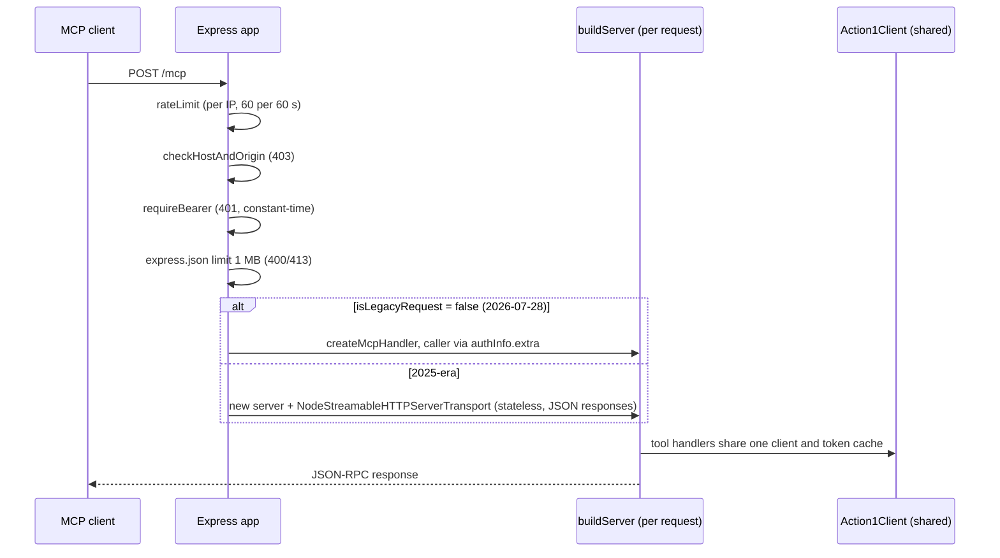

# Runtime, transports and request context

Use this page when changing process startup, the HTTP endpoint, how servers are built per connection, or anything that reads the per-call request context. Overview: [Architecture overview](overview.md). Settings are described in [Configuration](configuration.md).

## Entry point (`src/index.ts`)

- `parseArgs` accepts only `--http`, `--stdio`, `--port`, `--host`, `--help`/`-h`, `--version`; anything else throws `UsageError` (exit code 2). `helpText()` renders the environment section from `ENV_VARS` in `src/config.ts`, so help can never drift from the schema.
- Default is **stdio**: `startStdio()` calls `serveStdio(() => buildServer(client, { config }).server, { legacy: "serve" })`. One `Action1Client` is shared; the SDK decides the protocol era from the first message (`initialize` -> 2025-era, `server/discover` -> 2026-07-28 era), both from the same factory. SIGINT/SIGTERM exit 0.
- `--http` merges CLI `--port/--host` over `loadConfig().http`, builds `createHttpApp(cfg)`, listens, and on a signal closes the server with a 25 s hard exit.
- Failures: `ConfigError` prints one `action1-mcp: <issue>` line per problem then a JSON `fatal` log, exit 1, no stack trace. Uncaught exceptions and rejections write one JSON line (`logFatal`) first. `isEntryPoint` resolves symlinks (npm bin, macOS `/var` links) so tests can import the module without starting it (`tests/integration/binSymlink.test.ts`).
- Stdout is reserved for MCP; all logs go to stderr as JSON lines ([Redaction and audit](../security/redaction-and-audit.md)).

## HTTP transport (`src/http.ts`)

`createHttpApp(cfg, deps)` is pure (no listen, no signal handlers) so tests run the production middleware chain. `deps` can inject `client`, `serverFactory` and `rateLimit`.

*Caption: order is deliberate; the rate limit runs before Host/Origin and Bearer so token guesses are throttled, and the body is parsed only after all checks pass.*

- **Startup refusals** (`assertHttpStartupConfig`, throws `ConfigError`): no token and no `MCP_HTTP_ALLOW_NO_AUTH`; allow-no-auth on a non-loopback bind; wildcard bind (`0.0.0.0`, `::`) with empty `MCP_HTTP_ALLOWED_HOSTS`. Without a token but with the opt-out, a `http_auth_disabled` warning is logged.
- **Allowed Host names** = loopback names + normalised bind host (unless wildcard) + `MCP_HTTP_ALLOWED_HOSTS`; ports are ignored (`normaliseHostname`). A present `Origin` must be loopback or in `MCP_HTTP_ALLOWED_ORIGINS`.
- **Rejection audit lines** (`http_rate_limited`, `http_host_rejected`, `http_origin_rejected`, `http_auth_failed`) go through `log.audit` once per event/reason/peer per 60 s with a `suppressed_since_last` counter. Rate-limit and rejection maps are bounded at 10 000 entries (oldest evicted); `tests/performance/boundedState.test.ts` covers eviction.
- **Probes**: `GET /healthz` (liveness) and `GET /readyz` (config loads and `client.tokens.state()` is not `failing`; 200/503). Both answer outside the Bearer and Host checks and reveal only version and token state (known exposure, see [Backlog](../quickstart.md#backlog)).
- `GET`/`DELETE` `/mcp` -> 405 with `Allow: POST`. Error handler maps body-parser failures to JSON-RPC -32700/-32600 without echoing internals.
- `callerOf(req)` builds a `CallerIdentity` (`transport: "http"`, peer IP honouring `TRUST_PROXY`, truncated user agent, `token_id` = SHA-256 prefix from `tokenId`, never the token) that flows to every `tool_call` and audit line.
- Cancellation: closing the HTTP request cancels the running call; a separate `notifications/cancelled` request does not reach it on the stateless path (documented decision in `BACKLOG.md`, FAQ).

## Registration policy and request context

`buildServer(existingClient?, { config, caller })` in `src/server.ts`:

1. Creates `McpServer` with `maxToolInputElements: MAX_TOOL_INPUT_ELEMENTS` (100 000, advisory GHSA-46jr-4wx8-v453) and `serverInstructions(cfg)`; the guard section is rendered from the guard policy ([Destructive guard](../security/destructive-guard.md)).
2. Calls `applyToolPolicy` then `instrumentToolCalls` (`src/tools/registry.ts`) **before** any registration. They monkey-patch `server.registerTool` and the SDK's `setRequestHandler`: toolsets (`all` | `read` | `curated`, intersection) decide which tools register at all (`toolSelected`); every `z.ZodObject` input becomes `.strict()`; `tools/call` and `resources/read` handlers run inside `runWithRequestContext`, and `tools/call` ends with one `tool_call` event (`outcome` = `ok` | `error` | `dry_run` | `refused`, `duration_ms`, `attempts`, `upstream_status`, `org`, `caller`).
3. Registers modules in a fixed order: orgs, endpoints, templates, automations, execution, results, workflows, generated, wrappers, groups, raw, resources, prompts.
4. Logs `guard_config` (and `auto_confirm_enabled` warning) once per process.

`RequestContext` (`src/utils/requestContext.ts`, `AsyncLocalStorage`) carries `requestId`, `tool`, `attempts`, `upstreamStatus`, `orgId`, `guard`, `signal`, `caller` and `approvedExecution`. The client increments `attempts`, `resolveOrgId` sets `orgId`, the guard sets `guard` and `approvedExecution`, and `noteExecutionSent` consumes it. Code outside a tool call sees `undefined`; do not assume a context exists.

## Change guidance

- **Invariants**: registration order (policy before tools); one `buildServer` per HTTP request; `buildServer({config})` only partly honours the injected config (guard, org scope and PII masking read `loadConfig()`), so tests set env and call `resetConfigCache()`.
- **New CLI flag**: edit `parseArgs`, `helpText` and `tests/unit/cli.test.ts`; env settings instead belong in `EnvSchema` + `ENV_VARS` ([Configuration](configuration.md)).
- **New middleware or rejection**: keep the order above, log through `logRejection`, extend `tests/integration/httpTransport.test.ts`; coverage floors for `src/http.ts` are enforced in `vitest.config.ts`.
- **Protocol era behaviour**: `tests/integration/protocolVersions.test.ts` (2025-06-18, 2025-11-25) and `httpModernProtocol.test.ts` (2026-07-28).
- Expensive and conditional: `bun run test:coverage` only when touching `src/http.ts`; `bun run test:e2e` only when the built entry (`dist/index.js`) or bundle start changes.
