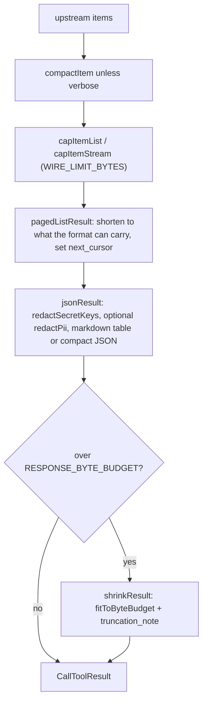

# Output shaping, size budgets and cursor pagination

MCP hosts reject tool results above roughly 1 MB and some only show `structuredContent` to the user while others feed only the text block to the model. All result building therefore lives in `src/tools/helpers.ts` and a small set of utilities; tools should never hand-roll `{ content: [...] }` for data results.

## Budgets (`src/constants.ts`)

| Constant | Value | Meaning |
|---|---|---|
| `CHARACTER_LIMIT` | 25 000 | soft cap on Markdown text of one result |
| `WIRE_LIMIT_BYTES` | 400 000 | cap on the *items list* portion (items appear twice on the wire) |
| `RESPONSE_BYTE_BUDGET` | 900 000 | whole serialised result (text + structured), enforced in `jsonResult` / `pagedListResult` |
| `COMPACT_STRING_CEILING` | 400 | per-string ceiling for `compactItem` |
| `MAX_LIST_LIMIT` | 50 000 | max `limit` input of list tools |
| `DEFAULT_PAGE_SIZE` | 200 | upstream page size |

## Result building

*Caption: the order of shaping steps for a list result; single objects skip compaction and paging and go straight to `jsonResult`.*

- `jsonResult(value, structured, format)` masks secrets/PII on both channels ([Redaction and audit](../security/redaction-and-audit.md)), defaults to Markdown for `{items: [...]}` (about 30-50 % smaller) and compact JSON otherwise, then falls back to `shrinkResult` if still too large.
- `cappedListResult` (complete in-memory list) and `cappedListResultFromStream` (paginated source, keeps only what fits while counting the rest for an exact `total`) are for non-cursor lists.
- `compactItem` shortens string-heavy fields (`script_text`, `description`, `security_CVE`, `summary`, `notes`, ...) and replaces structurally heavy ones (`EULA_text`, `additional_actions`, ...) unless `verbose: true`. `compactionNote` adds a hint only when something was actually compacted, naming `verbose` only for tools that have that parameter.
- `renderMarkdownTable` returns the text and number of rows rendered; `pagedListResult` iterates until the table shows every row of the page so text-only hosts never silently skip rows, and `next_cursor` moves to the first row not shown. In JSON mode `fitItemsToWire` trims the page to the budget.
- Errors are built with `errorResult`/`actionableError`; `runTool` maps `Action1ApiError`, `ZodError` and `AbortError` to uniform tool errors ([Action1 client](../architecture/action1-client.md)).

## Cursor protocol (`src/utils/cursor.ts`)

- Wire format: base64 JSON `{ from, q?, n? }` - upstream offset, 16-hex query fingerprint (`fingerprintQuery`, ignores `cursor` and `limit`), and number of items already returned (enables the real `total` on the last page).
- `pagedFetch(fetchPage, opts)` walks upstream pages (`FetchedPage` with `hasMore` / `hasMoreFromEnvelope`) until the byte cap, `maxItems`, `maxPages` or exhaustion. A client-side `filter` keeps the cursor on *upstream* positions, so filtered walks neither skip nor repeat matches. A single record larger than the cap becomes a `__truncated_item` placeholder so the walk always advances. `resumeAfter(k)` lets `pagedListResult` shorten a page without losing rows.
- `resolveCursor` rejects unparsable cursors and fingerprint mismatches with `CursorError`; the server instructions tell the model to loop on `has_more` ([Runtime and transports](../architecture/runtime-and-transports.md) `serverInstructions`).
- Upstream envelope parsing (`parsePageEnvelope`, `pageHasMore`, `envelopePage`) is in `src/client/pagination.ts` ([Action1 client](../architecture/action1-client.md)).

## Generated list tools (`runGenerated`)

`src/tools/generated/runtime.ts` is hand-written (codegen never touches it). For GET tools with `cursor` or `auto_paginate` it calls `pagedFetch` with per-item compaction; otherwise it returns one upstream page, still reporting `has_more`/`next_cursor` for tools the spec marks as paged (`paginated: true`). Before any call it runs `assertSafeApiPath` and `assertPayloadOrgsAllowed`, and wraps mutating operations in `runDestructive` ([Destructive guard](../security/destructive-guard.md)). Open edge: for a capped page `next_cursor` is `from + limit`, which assumes the upstream honours `from` (see [Backlog](../quickstart.md#backlog)).

## Change guidance

- New list tool: use `...cursorInputShape`, `...formatShape`, `cursorListOutputShape`, a `fingerprintQuery` over the filter arguments, `pagedFetch`, and return through `pagedListResult`. Do not paginate just to count; add a `*_summary`-style tool instead.
- Changing budgets or Markdown rendering: run `tests/performance/cap.test.ts` (measures serialised work, not wall-clock) and `tests/unit/markdownTable.test.ts`.
- Changing cursor encoding is a compatibility break for in-flight walks only; still keep `parseCursor` tolerant of cursors without `q`/`n`.
- Not usually needed: `bun run test:coverage` or e2e.
