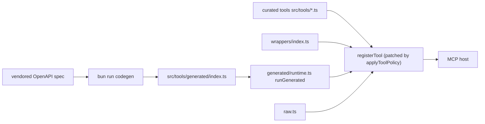

# MCP tool, resource and prompt surface

The server registers everything in `buildServer` (`src/server.ts`) on a fresh `McpServer` per call. Order matters: `applyToolPolicy` and `instrumentToolCalls` run first ([Runtime and transports](../architecture/runtime-and-transports.md)), then the `register*` functions below, then resources and prompts. Operator-level tool documentation is `docs/USAGE.md` (held in sync by `tests/integration/usageDocs.test.ts`); a generated list of every API operation and its tool is `docs/_coverage_table.md`; required Action1 role permissions per tool are in `docs/permissions.md` (generated from spec permission tags by `scripts/generate-permissions-table.mjs`). Tool counts change with each spec refresh, so do not hand-write them (`tests/unit/docsConsistency.test.ts`).

## Two layers (ADR 0002)

*Caption: curated tools win name collisions; the generator drops any generated tool whose name a curated file already registers.*

| Family | Entry (`src/tools/`) | What it is for |
|---|---|---|
| Org / endpoints | `orgs.ts`, `endpoints.ts` | `action1_list_organizations`; cursor-paginated `action1_list_endpoints`, `action1_search_endpoints` (client-side substring), `action1_get_endpoint` (adds `connectivity.online`), `action1_endpoints_summary` (server-side counts), per-endpoint missing updates and vulnerabilities |
| Execution | `execution.ts`, `startAction.ts` | `action1_run_script` (OS auto-route), `run_powershell`, `run_bash_macos`, `reboot_endpoint`, template tools (`deploy_update`, `deploy_package`, `uninstall_program`, `run_data_collection`) - all destructive-guarded, see [Script execution](../workflows/script-execution.md) |
| Results / workflows | `results.ts`, `workflows.ts`, `automations.ts`, `templates.ts` | status/output readers, `action1_wait_for_automation`, `action1_execute_and_wait`, recent-automation list and `action1_automations_summary`, action-template catalog |
| Groups | `groups.ts` | `action1_add_endpoint_to_group` / `remove_...` (replace a generated tool that could not send the array body; payload in `src/payloads/groupContents.ts`) |
| Wrappers | `wrappers/index.ts` | composed read workflows: `audit_log_search`, `cve_remediation_plan`, `endpoint_groups_resolve` (fuzzy), `recurring_schedules`, `report_export` (CSV sanitised), `software_inventory_for_endpoint` |
| Raw | `raw.ts` | `action1_raw_request`: any documented path; writes are always account operations ([Destructive guard](../security/destructive-guard.md)) |
| Generated | `generated/index.ts` | one tool per remaining spec operation, shared runtime in `generated/runtime.ts` ([Codegen and spec](../workflows/codegen-and-spec.md)) |

Curated readers never hard-code Action1 field names: they go through `src/spec/entities.ts` (spec name first, legacy name second; spec values recorded in `SPEC_USAGE` and checked by `tests/unit/specContract.test.ts`). Action1 timestamps (`YYYY-MM-DD_HH-MM-SS`) go through `src/spec/time.ts`.

## Resources and prompts

- Resources (`src/resources/index.ts`, all JSON, errors mapped through `safeResourceRead`): `action1://me`, `action1://orgs`, `action1://templates`, `action1://reports`, and templates `action1://endpoints/{orgId}`, `action1://vulnerabilities/{orgId}`, `action1://groups/{orgId}`. The two big lists load fully before capping (backlog item).
- Prompts (`src/prompts/index.ts`): `patch-windows-fleet`, `audit-vulnerabilities`, `triage-offline-endpoints`, `run-script-fleetwide`, `software-inventory-sweep`, `check-my-permissions`. Prompt arguments are strings; destructive steps must default to `dry_run: true` and ask the user before executing. `tests/integration/runScriptFleetwide.test.ts` replays the prompt's prescribed call.

## Toolsets and annotations

`ACTION1_TOOLSETS` (`all` | `read` | `curated`, intersection) is applied at registration by `toolSelected`: `read` keeps `readOnlyHint:true` tools, `curated` drops names in `GENERATED_TOOL_MANIFEST`. Consequently every new tool must set `annotations` honestly (`readOnlyHint`, `destructiveHint`, `idempotentHint`, `openWorldHint`); a mutating tool marked read-only would survive `ACTION1_TOOLSETS=read`. Destructive tools stay visible without `ACTION1_ALLOW_DESTRUCTIVE` so previews work.

Output schemas are permissive `.passthrough()` objects (`listOutputShape`, `cursorListOutputShape`, `singleObjectOutputShape`, `objectOutputShape(fields)` in `src/tools/helpers.ts`) so extra upstream keys never fail host validation. Result formatting and size limits live in [Output shaping and pagination](output-and-pagination.md).

## Compatibility contract

`tests/fixtures/tools-list.baseline.json` (written by `scripts/tools-list-snapshot.mjs` from the v0.5.0 build) is the public-surface baseline. `tests/integration/toolsListBaseline.test.ts` fails on removed tools, input properties, resources, prompt arguments, new required inputs, changed annotations or dropped output schemas; additions pass. It does not compare input types or enums (several were narrowed deliberately in 0.6.0). CI also runs `scripts/assert-baseline-tools.mjs` against a built server snapshot ([Build, release and CI](../delivery/build-release-and-ci.md)).

## Change recipes

See [Change recipes](../workflows/change-recipes.md) for adding a curated tool, wrapper, resource, prompt, or overriding a generated tool. Consumer-facing smoke for any new tool: it must appear in `tools/list` through the in-memory harness (`tests/helpers/mcpHarness.ts`, `connectHarness`) and in `docs/USAGE.md`.
