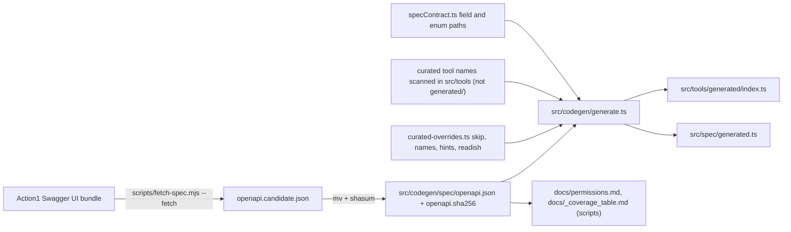

# OpenAPI codegen and spec snapshot management

ADR 0002 (`docs/adr/0002-hybrid-tools-from-vendored-spec.md`) explains why: the Action1 API has well over a hundred operations; plain CRUD is generated, quirky workflows are [curated](../domain/tool-surface.md). Action1 only ships its OpenAPI spec embedded in the Swagger UI bundle, so the project vendors a pinned snapshot and generates committed code from it, making spec updates reviewable diffs.

*Caption: generator inputs and committed outputs; `src/tools/generated/runtime.ts` is hand-written and untouched by codegen.*

## Generator contract (`src/codegen/generate.ts`)

- Run: `bun run codegen` (`tsx src/codegen/generate.ts`). Writes `src/tools/generated/index.ts` (one `registerTool` per operation, plus `GENERATED_TOOL_MANIFEST` and `GENERATED_SKIPPED_OPERATIONS`, used by [toolsets](../domain/tool-surface.md#toolsets-and-annotations) and the raw tool's org-path check) and `src/spec/generated.ts` (field names and enum values curated readers use, from paths in `specContract.ts`).
- Aborts without writing when: spec SHA differs from `openapi.sha256`; a `NAME_OVERRIDES` / `OPERATION_DESCRIPTION_HINTS` key is not an operationId; a `READISH_OPERATION_IDS` key is not a POST; a name cannot be shortened to the 64-character MCP limit; two tools collide; a `specContract.ts` path no longer resolves.
- Naming (`naming.ts`): verb-first `action1_<verb>_<resource>` derived from method+path with a 3-pass conflict resolver; namespace segments (`all`, `managed`, `custom`) are transparent. Curated names are collected by scanning every `.ts` under `src/tools/` except `generated/` for literal `registerTool("action1_...")` names (`extractCuratedToolNames`); a generated tool with the same name is dropped. `tests/integration/generatedTools.test.ts` cross-checks the scan against what the real server registers, so non-literal registrations fail the test instead of crashing startup with a duplicate name.
- Safety invariants: all mutating operations get `confirm`/`dry_run`/`destructiveHint`; `READISH_OPERATION_IDS` is a reviewed allowlist (no title heuristics); `SKIP_OPERATION_IDS` holds `oauth2_token` (handled by `TokenProvider`) and `endpoints_groups_groupId_contents_post` (replaced by curated group tools). Output schemas come from the 200 response (`outputSchema.ts`: list / single / ok-status); request bodies and params become Zod source (`zodEmit.ts`).

## Spec contract and undocumented endpoints

- `src/spec/entities.ts` registers every spec field/enum it reads in `SPEC_USAGE`; `tests/unit/specContract.test.ts` verifies each against `components.schemas`, so drift fails CI instead of silently mis-reading records. Add a new field via `specContract.ts`, run codegen, then use it in a reader.
- Curated tools that call paths absent from the spec (`/policies/instances/{orgId}`, per-endpoint `.../vulnerabilities`) must be listed in `known-undocumented-endpoints.json`; `tests/unit/curatedPaths.test.ts` fails on unlisted undocumented paths and on listed paths that become documented or unused. Details: `docs/GOTCHAS.md`.

## Drift detection and refresh

- `bun run spec:check` (`scripts/fetch-spec.mjs --check`): exit 0 unchanged, 1 drift (with added/removed/changed summary), 2 fetch/parse failure. `.github/workflows/spec-drift.yml` runs it weekly; a red run means refresh.
- Refresh (full procedure in `src/codegen/spec/SOURCE.md`): `bun run spec:fetch` -> move candidate over `openapi.json` -> write new SHA to `openapi.sha256` (lowercase hex, no newline) -> `bun run codegen` -> fix stale overrides/collisions -> `bun run test` -> update SOURCE.md stats -> commit spec, SHA and generated files together. Never update the SHA without regenerating. Also regenerate derived docs: `node scripts/generate-permissions-table.mjs` and `node scripts/regenerate-coverage-table.mjs` (`--check` variants run inside `permissionsTable.test.ts` / `docsConsistency.test.ts`).
- The spec is Action1's work and is not under the project's MIT licence (`NOTICE`).
- Spec refreshes ripple outward: PII keys (`tests/security/pii.test.ts` derives them from the spec), the v0.5.0 baseline (additions pass, removals fail), `docs/api-coverage.md`.

## Change guidance

| Intent | Edit | Check |
|---|---|---|
| Rename/skip/override one generated tool | `src/codegen/curated-overrides.ts` (comment why) -> `bun run codegen` | `tests/unit/curatedOverridesAssertion.test.ts`, `generatedTools.test.ts`, baseline test (renames break consumers) |
| Change how every generated tool behaves | `src/tools/generated/runtime.ts` (hand-written) | `tests/unit/runtime.test.ts`, `tests/unit/generatedMutationRetry.test.ts`, `generatedTools.test.ts` |
| Change emitted code shape | `generate.ts` / `zodEmit.ts` / `outputSchema.ts` -> regenerate | `tests/unit/codegenGenerator.test.ts`, `paramZod.test.ts`, `outputSchemas.test.ts`, `specSha.test.ts` |
| Adopt a new spec | procedure above | the CI `codegen-roundtrip` job equivalent: `bun run codegen` then `git diff --exit-code` |

Escalate to the full `bun run test` only for spec refreshes or generator changes, because they change many tools at once. `bun run build:mcpb` is not needed: the codegen directory is excluded from the shipped package (`package.json` `files`).
