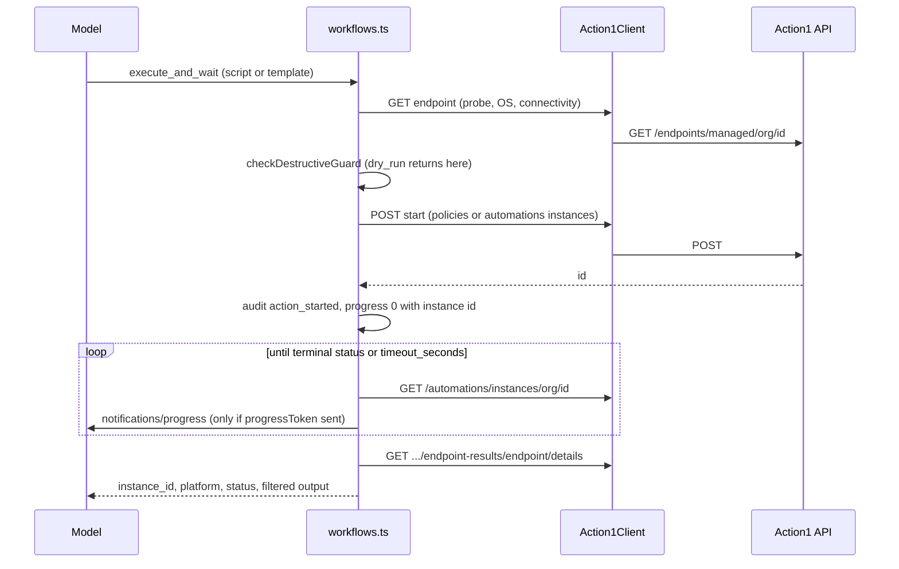

# Script execution, template actions and execute-and-wait

This is the highest-risk path in the repo: it runs code on managed endpoints. Consult it before touching `src/tools/execution.ts`, `startAction.ts`, `workflows.ts`, or any `src/payloads/*` builder. The guard semantics live in [Destructive guard](../security/destructive-guard.md); HTTP semantics in [Action1 client](../architecture/action1-client.md).

## Start path (`src/tools/startAction.ts`)

1. **Resolve platform** - `resolveScriptPlatform`: for `target_type: "EndpointGroup"` the caller must pass `os` (`windows`|`macos`), no upstream call; for a single endpoint `probeEndpoint` does one GET (`fetchEndpointInfo`, canonical `/endpoints/managed/{org}/{id}` with list fallback on 403/404), applies the connectivity check (`isEndpointActuallyOnline` with `ACTION1_LAST_SEEN_STALE_MINUTES`; Action1 reports `Connected` even when `last_seen` is hours old, so `connectivity.online` is derived), then `detectPlatform` (Linux/unknown is refused). `skip_connectivity_check` bypasses the offline abort. Because the preview body depends on the OS, **a dry run makes this GET**.
2. **Build the request** - `buildScriptRequest(platform, input, cfg)` is the only OS switch: Windows -> `POST /policies/instances/{org}` via `buildWindowsPowerShellPayload` (non-empty `success_exit_codes`, default `"0"`, `timeout_minutes` and `retry_minutes` from config defaults); macOS -> `POST /automations/instances/{org}` via `buildMacOsBashPayload` (ten `run_script` params; omitting any makes Action1 silently mark the action "not applicable to Mac"). Template tools use `buildSimplePolicyPayload` (`deploy_update`, `deploy_package`, `uninstall_program`, `run_data_collection`, reboot).
3. **Guard -> POST** - `startAction` runs `runDestructive` with a preview of the exact request, optional `beforePost` hook (never reached by a dry run), then `client.request(..., { method: "POST", retry: false })`.
4. **Instance id** - `startedJobResult`/`extractInstanceId` read `id` or `instance_id`; if absent the result is an error (`no_instance_id`, body masked) instead of a success with `undefined`.

`/policies/instances/{org}` is not in the pinned spec; it is listed in `src/codegen/spec/known-undocumented-endpoints.json` and explained in `docs/GOTCHAS.md` (long-term fix is moving Windows to `/automations/instances` after a live re-test).

## Execute and wait (`action1_execute_and_wait`)

*Caption: guard runs after the pre-flight GET and before the POST; after the id exists every failure message carries it.*

- It duplicates the start sequence of `startAction` (own POST and id parsing) - a known drift risk in the [Backlog](../quickstart.md#backlog). A 4xx on start means nothing started; any other failure appends "the action may have started" and points to `action1_list_recent_automations`.
- `waitForInstance` stops only on `isTerminalAutomationStatus` (statuses from `src/spec/entities.ts`, `AUTOMATION_TERMINAL_STATUSES`); timeout raises `Action1TimeoutError` with the last status masked. It sleeps a full interval without clamping to the deadline, so `timeout_seconds` can be exceeded by up to one interval.
- Progress: if the request carries `_meta.progressToken`, `announceStart` sends progress 0 (with the instance id so a client that gives up can still check status) and `progressReporter` one notification per poll. Clients that neither request progress nor reset their timeout lose the id if their timeout is shorter than `timeout_seconds` (public-surface limitation in the Backlog; docs advise a shorter timeout or start tools plus `action1_wait_for_automation`).
- Output: `fetchFilteredOutput` calls the endpoint-results details and `filterEndpointResultDetails` strips lifecycle status markers (`isStatusMarker`) from script output.
- `action1_wait_for_automation` is read-only and idempotent: it polls an existing instance (optionally fetching output for an endpoint) and its error text tells the model to call it again to keep waiting.

Result readers in `src/tools/results.ts` (`action1_get_automation_status`, `..._results`, `..._output`) share the same filter.

## Change guidance

- **New payload field / template tool**: change the builder in `src/payloads`, update its payload test (`*.payload.test.ts` pin required fields), then `tests/integration/policy.test.ts` / `workflows.test.ts`. Template tools register through `registerTemplateTool` in `execution.ts` and must keep the guard shape and destructive annotations.
- **New status handling**: edit `src/spec/entities.ts` (spec names first) and `tests/integration/specShapes.test.ts`.
- **Connectivity logic**: `tests/unit/lastSeen.test.ts` covers Action1's non-ISO `last_seen` format; threshold behaviour in `tests/integration/lastSeenThreshold.test.ts`.
- Never add retries to a start POST. Anything that issues a state-changing request must still go through the guard so `destructive_executed` is logged.
- Live verification of payload changes is manual (sacrificial endpoint; see `TESTING.md` live smoke tests); no automated test reaches a real tenant.
